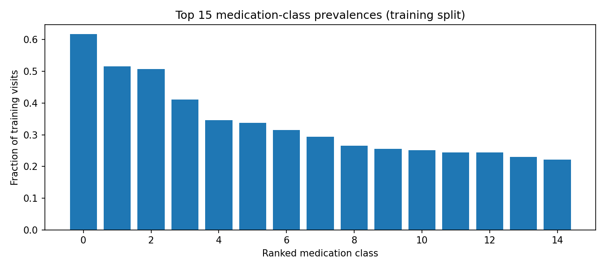

# MediAssist-AI

**Personalized medication-class recommendation and drug interaction analysis**

Phase I is a reproducible academic research prototype that predicts historical medication classes from ICU-derived data and demonstrates how recommendation results can be accompanied by interaction and reference checks.

> **Research prototype only.** This project is not a medical device, diagnostic tool, or prescribing system. Its outputs are historical ATC medication-class rankings, not treatment advice. Do not use it to make decisions about patient care.


## Results at a glance

The recommendation model is a one-vs-rest logistic-regression classifier implemented with scikit-learn `SGDClassifier(loss="log_loss")`. It ranks 107 ATC level-4 medication classes from diagnosis, demographic, and conservatively filtered procedure features.

| Held-out test metric | Frequency baseline | Logistic-regression model |
|---|---:|---:|
| Micro-precision | 0.3304 | 0.3535 |
| Micro-recall | 0.5350 | 0.5725 |
| Micro-F1 | 0.4085 | 0.4371 |
| Samples Jaccard | 0.2464 | 0.2694 |

Evaluation used a patient-level split: train 16,110 visits / 7,368 patients; validation 3,431 / 1,578; test 3,447 / 1,580. These metrics measure prediction of historical medication-class use. They do not establish clinical effectiveness or safety. Standard accuracy is not reported as the primary metric for this multi-label task.

## What is implemented

- Audited derived dataset artifacts for 22,988 visits, 10,526 patients, and 107 medication-class targets.
- Patient-level train, validation, and test splits, with conservative filtering of medication-like procedure features to reduce leakage.
- A trained sparse one-vs-rest logistic-regression model and a frequency-based comparison baseline.
- Medication class/index mapping and a conservative DDI matrix lookup. A missing interaction record is not treated as proof of safety.
- Basic rule-based extraction from fictional, labelled text; input completeness checks; age/reference checks; and a notebook-based end-to-end report.

The end-to-end example is fictional. Diagnosis-vocabulary indices are explicitly supplied; symptoms are not automatically mapped to diagnoses. The text extractor is not a trained clinical NLP model. The project has no production web UI, login, patient record system, or deployed service.

## Architecture

```text
Fictional labelled input
	-> rule-based extraction and completeness checks
	-> supplied research diagnosis indices + demographics
	-> trained medication-class ranking model
	-> ATC class mapping and DDI/reference lookups
	-> structured research report with limitations
```

The DDI and age/reference components are lookup/rule-based support code, not separately trained models. Verified generic/brand mappings, real dosage and age restrictions, and DDI severity/mechanism data are not available in this package, so those facts are not invented.

## Run the project

From the project root, install the listed dependencies and run the complete local workflow:

```bash
pip install -r requirements.txt
bash run_phase1.sh
```

The notebook can be opened directly as `MediAssist_AI_Phase1.ipynb`. The saved example report is `reports/end_to_end_demo.json`.

To run tests separately:

```bash
python3 -m unittest discover -s tests -v
python3 integration/run_synthetic_tests.py
```

The recorded project results are 8 passing unit tests, 431 passing synthetic software checks, and successful execution of all 14 notebook code cells. Synthetic checks test software behavior only; they are not medical validation.

Rebuilding the dataset package from original source files requires the authorized source bundle, which is not included here:

```bash
bash reproduce.sh /path/to/authorized/original-csv-bundle
```

## Repository guide

```text
MediAssist-AI/
├── MediAssist_AI_Phase1.ipynb  # executable research walkthrough
├── code/                       # training, package building, report generation
├── data/                       # derived model data, DDI data, mappings, test cases
├── integration/                # inference, NLP prototype, safety checks, demo
├── models/                     # saved model, configuration, evaluation metrics
├── reports/                    # audits, data documentation, results, demo output
└── tests/                      # focused automated tests
```

Start with `PHASE1_REPORT.md` for implementation details, `reports/final_report.md` for the data audit, and `reports/phase1_independent_audit.md` for independent verification notes.

## Data, safety, and limitations

- Data provenance and redistribution licensing are not confirmed. Verify authorization before publishing or sharing any dataset artifacts; remove restricted data from a public repository.
- The available data are ICU-derived and are not validated for pediatric, outpatient, India-specific, or other populations.
- Medication outputs are ATC level-4 classes, not individual drugs. Drug names and brands remain unverified.
- The real clinical reference template has no verified dosage or age-suitability facts. DDI source coverage is incomplete and lacks severity/mechanism details.
- `ehr_cooccurrence_full_data_LEAKS_TEST.npy` is explicitly a leakage-test artifact, not a model input. Synthetic files are for software tests only.
- The original source bundle is absent, so full source-to-derived-data reproducibility and provenance cannot be independently confirmed from this repository alone.

See `data/manifest.csv`, `data/clinical_reference/reference_sources_needed.md`, and the reports above for the artifact inventory and audit findings.
